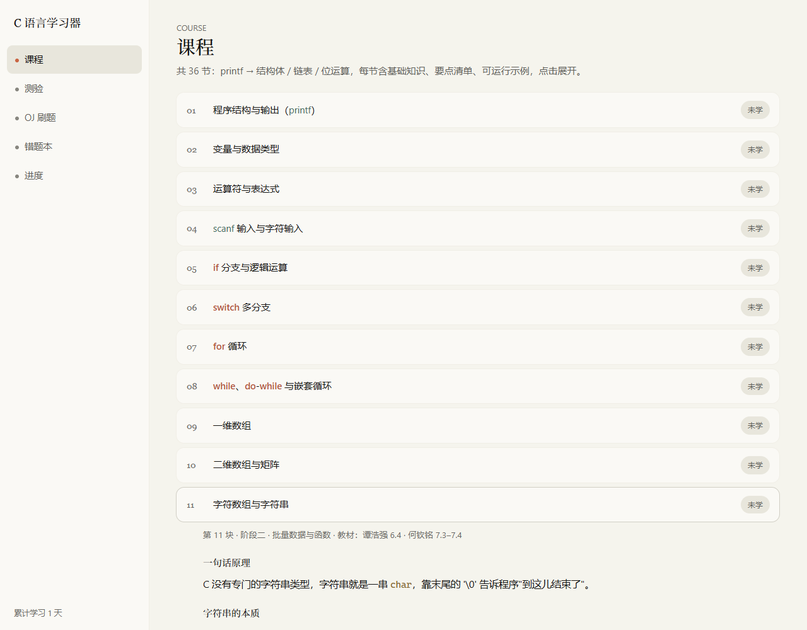
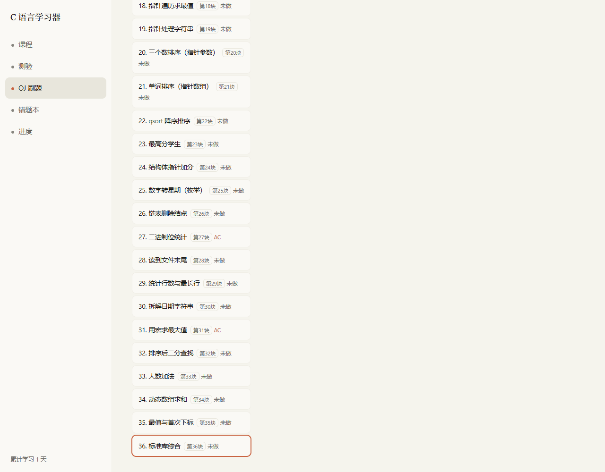
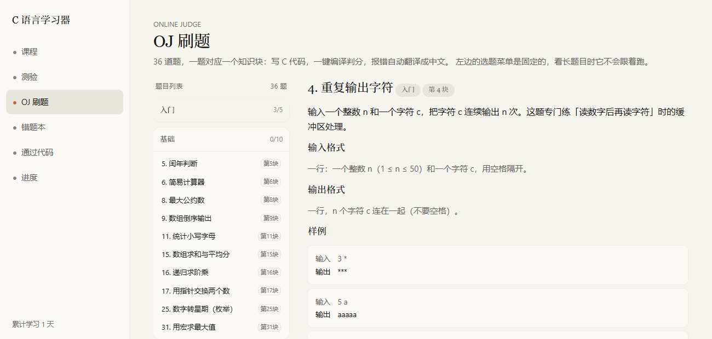
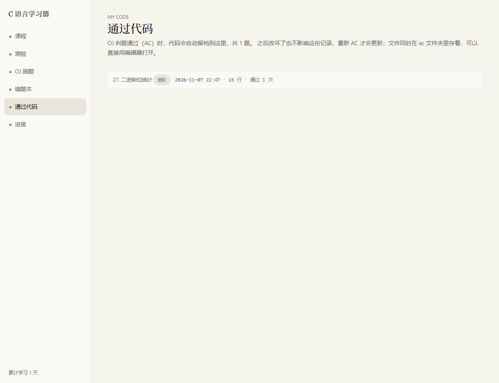
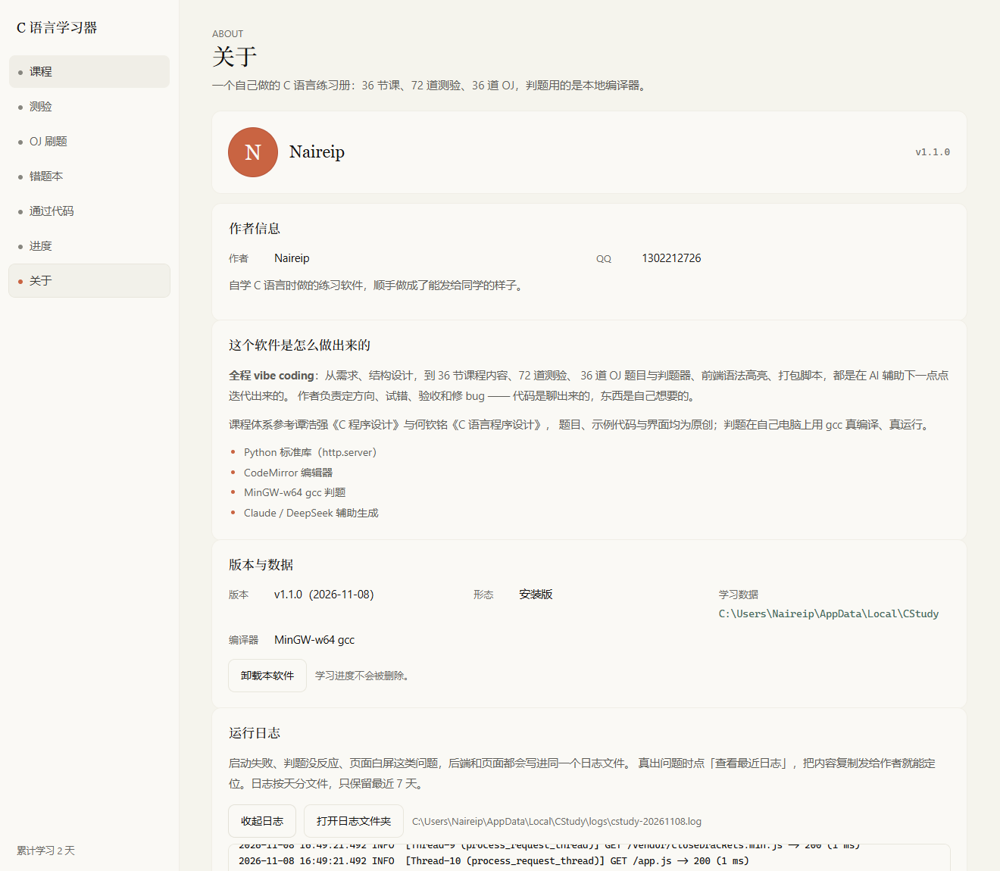

# C 语言学习器 · CStudy

一套自己从零做的 C 语言自学软件：**36 节课程 · 72 道测验 · 36 道 OJ 判题**。
判题在本机用 gcc 真编译、真运行，不联网、不上传代码。

零第三方依赖（Python 标准库 + 本地 CodeMirror），打完包发给同学，双击即用。

| | |
|---|---|
| 版本 | **1.1.0**（2026-11-08） |
| 平台 | Windows 10 / 11 x64 |
| 运行环境 | 源码运行需 Python 3.8+；打包版不需要 Python |
| 第三方依赖 | 无（只用 Python 标准库；OJ 判题需要 gcc） |
| 作者 | Naireip（QQ 1302212726） |

---

## 截图

**课程**：一句话原理 → 基础知识 → 要点清单 → 可编译示例 → 动手改 → 坑，正文和代码块都有语法高亮。



**OJ 刷题**：左侧固定二级菜单（按难度分组，显示已通过/总数），右侧题目 + CodeMirror 编辑器。





**通过代码**：AC 的代码自动留档，随时翻、一键复制。



**关于页 + 运行日志**（1.1.0 新增，出问题直接看日志或复制给作者）：



---

## 功能

| 页面 | 做什么 |
|---|---|
| 课程 | 36 节课，覆盖 printf → 指针 → 结构体/链表 → 文件/算法/动态内存。每节七块：原理 / 基础知识 / 要点 / 示例代码 / 动手改 / 常见坑 / 教材章节对照 |
| 测验 | 72 道四选一（36 个知识块 × 2 道），选块 → 逐题作答 → 即时判分 + 解析 → 存档 |
| OJ 刷题 | 36 道题，一题对应一个知识块。网页里写 C 代码，一键编译判分，gcc 报错翻成中文 |
| 错题本 | 答错的测验 + 没通过的 OJ，集中复习 |
| 通过代码 | AC 的代码自动留档（`ac/problem_N.c`），页面可翻可复制；之后改到 WA 也不覆盖 |
| 进度 | 课程状态 + 测验得分 + OJ 通过情况 + 累计学习天数 |
| 关于 | 作者信息、技术说明、版本、数据目录、**运行日志**、安装版带卸载按钮 |

---

## 快速开始

### 方式一：安装包（推荐发给同学）

```
release\CStudy-Setup-1.1.0.exe
```

向导安装，**不弹 UAC**（装到用户目录），桌面 / 开始菜单快捷方式名 **CStudy**，卸载走「设置 → 应用」。
学习进度存在 `%LOCALAPPDATA%\CStudy`，卸载不会删。

### 方式二：便携版（免安装）

```
release\C语言学习器-完整版.zip   →  解压后双击 exe
```

自带 63 MB 裁剪版 MinGW，对方机器不用装任何东西。

### 方式三：从源码运行（开发）

```bash
python server.py
```

或者双击 `启动学习器.bat`。会自动：

1. 起本地服务 `http://127.0.0.1:8765/`（端口被占自动顺延到 8766、8767…）
2. 自动打开浏览器
3. 关掉黑色命令行窗口 = 退出

判题需要 gcc，按这个顺序找：`CSTUDY_GCC` 环境变量 → 程序旁 `compiler\bin\gcc.exe` → `D:\w64devkit\bin\gcc.exe` → MSYS2 → `C:\MinGW` → PATH。
**找不到编译器不会崩**：OJ 会提示「找不到 C 编译器」，课程和测验照常用。

---

## OJ 判题是怎么工作的

```
你的代码 ──写入 oj/problem_N.c──▶ gcc -std=gnu99 -O2 ──▶ .exe ──▶ 逐组样例喂 stdin ──▶ 比对 stdout
```

- 编译超时 30 秒；每组样例运行超时默认 2 秒（题目里可配 `time_limit`）
- 输出比对按 **token**（忽略多余空格/换行），所以题目必须写死输出格式
- 五种结果：`AC` 通过 / `WA` 答案错误（显示你的输出 vs 期望）/ `CE` 编译错误（**中文报错**）/ `TLE` 超时 / `RE` 运行错误（退出码）
- 每次提交都进「提交记录」（最多保留 300 条），AC 的代码另存一份到 `ac/problem_N.c`
- `judge.py` 里的 `_translate_msg()` 把常见 gcc 报错翻成人话：漏分号、漏大括号、变量没声明、把 `==` 写成 `=`、混入中文标点……

---

## 项目结构

```
CStudy-GUI/
├─ server.py              # 本地服务 + API（http.server，零依赖）
├─ judge.py               # OJ 判题：找 gcc / 编译 / 跑样例 / 报错中文化
├─ applog.py              # 运行日志（按天切、留 7 天、前后端共用一个文件）
├─ appinfo.py             # 版本号 / 作者 / 快捷方式名（改版号只改这里）
│
├─ static/                # 前端（无构建步骤，浏览器直接加载）
│  ├─ index.html          # 页面骨架
│  ├─ style.css           # Claude 风格令牌 + 布局 + 深色编辑器主题
│  ├─ app.js              # 全部交互：路由、渲染、高亮、判题、日志上报
│  ├─ icon.ico            # 浏览器标签图标
│  └─ vendor/             # CodeMirror 5（本地化，离线可用）
│
├─ 课程数据
│  ├─ lessons.py          # 总装：_A + _B + _C + _D = 36 节
│  ├─ lessons_a.py        # 第 1~9 块   基础语法 / 数组
│  ├─ lessons_b.py        # 第 10~18 块 字符串 / 函数 / 指针
│  ├─ lessons_c.py        # 第 19~27 块 指针深化 / 结构体 / 链表 / 位运算
│  ├─ lessons_d.py        # 第 28~36 块 文件 / 工程化 / 算法 / 动态内存 / 调试 / 标准库
│  ├─ quizzes.py          # 测验 72 道
│  ├─ oj_bank.py          # OJ 题库 36 道（id = 知识块号）
│  ├─ answers.py          # 参考答案汇总入口
│  └─ answers_a/b/c.py    # OJ 1~14 / 15~27 / 28~36 的 reference + best
│
├─ 数据与产物
│  ├─ progress.json       # 学习进度（开发模式）；打包版在 %LOCALAPPDATA%\CStudy
│  ├─ oj/                 # 每题草稿 problem_N.c
│  ├─ ac/                 # AC 留档 problem_N.c
│  ├─ logs/               # 运行日志 cstudy-YYYYMMDD.log
│  └─ release/            # 安装包 / 便携版 zip
│
├─ 自检脚本（见下表）
├─ _tools/                # 验收与打包辅助脚本
├─ docs/screenshots/      # README 配图
└─ 知识地图.md            # 36 块全景 + 教材对照 + 出题排期
```

### 自检脚本

| 脚本 | 验什么 |
|---|---|
| `verify_lessons.py` | 结构检查 + 36 段示例代码真编译（含 `-Wall` 警告） |
| `run_lessons.py` | 把不需要输入的示例真跑一遍，查死循环 / 崩溃 |
| `verify_oj.py` | 36 题 × (reference AC + best AC + 错误代码 WA) |
| `quiz_check.py` | 测验页：36 块都能开、每题 2 道、作答有反馈（跑完还原进度） |
| `highlight_check.py` | 语法高亮：着色生效且文本逐字未变 |
| `ac_check.py` | AC 留档：WA 不留 / AC 落盘 / 再 WA 不覆盖 / 页面展示 |
| `e2e_check.py` | 端到端：起服务 → API 判题 → 浏览器渲染 |
| `_tools/log_check.py` | 日志 18 项：请求耗时 / 判题 / CE / 404 / 前端上报 / 坏进度文件 |
| `_tools/about_log_check.py` | UI：关于页日志卡片能读，JS 报错会写进日志 |
| `_tools/ojmenu_check.py` | OJ 二级菜单：分组 / sticky / 换题回顶 |
| `_tools/editor_style_check.py` | 编辑器配色 |
| `_tools/offline_check.py` | 断网降级提示 |
| `_tools/about_check.py` | favicon / 标题 / 作者字段 / 不该出现的隐私字段 |
| `_tools/verify_installer.py` | 安装包：安装 / 快捷方式 / 注册表 / 启动耗时 / 静默卸载 |
| `_tools/test_portable.py` | 便携版：无编译器降级 / 双开换端口 / 页面渲染 |
| `_tools/readme_check.py` | 本文档提到每个文件和图片是否真实存在（39 个引用） |

---

## 想加内容（改完要重启）

出题就是直接改 Python 列表，没有后台、没有数据库。

| 想加什么 | 改哪里 | 改完验证 |
|---|---|---|
| 课程 | `lessons_a.py`、`lessons_b.py`、`lessons_c.py`、`lessons_d.py`（字段见文件头注释） | `python verify_lessons.py` |
| 测验题 | `quizzes.py` 的 `QUIZZES` | `python quiz_check.py` |
| OJ 题 | `oj_bank.py` 加题目 + `answers_*.py` 加 `reference`/`best` | `python verify_oj.py` |
| 界面样式 | `static/style.css`（令牌都在 `:root`） | `python _tools/editor_style_check.py` |
| 判题 / 报错翻译 | `judge.py` | 提交一次错误代码看提示 |

**两个必须记住的规则：**

1. **改完数据文件必须重启**（关掉黑窗口重新双击），Python 有模块缓存，不然页面还是旧数据。
2. `QUIZZES` 的 `answer` 是**下标 0~3**，不是 `"A"~"D"`。

课程每条数据的字段：

```python
{
    "block": 6,                      # 知识块编号（1~36）
    "part": "阶段一 · 基础语法与流程控制",
    "ref": "谭浩强 4.4 · 何钦铭 3",   # 教材章节
    "title": "switch 多分支",
    "idea": "一句话讲清它在干什么",
    "basics": [["小节标题", "正文"], ...],
    "points": ["要点 1", "要点 2", ...],
    "code": r"""#include <stdio.h>...""",   # 用 r""" 原始字符串
    "task": "动手改一改",
    "pitfall": "一句话坑",
}
```

---

## 运行日志与排错（1.1.0 新增）

软件发给别人后，出问题没法远程调试，所以前后端都往同一个文件写日志。

**位置**：`<数据目录>\logs\cstudy-YYYYMMDD.log`（按天切，保留 7 天）

- 打包版 → `%LOCALAPPDATA%\CStudy\logs\`
- 源码运行 → 项目目录下 `logs\`

**记什么：**

| 类型 | 例子 |
|---|---|
| 启动信息 | 版本、是否打包、程序目录、数据目录、端口、gcc 找到没有 |
| 每个请求 | `GET /api/data -> 200 (9 ms)` |
| 判题 | `判题 #1（A+B）→ CE，46 ms，代码 1 行` + 中文编译错误 |
| 异常 | 主线程 / 子线程未捕获异常的完整堆栈 |
| 进度文件损坏 | 记 ERROR + 把坏文件改名成 `progress.json.broken-<时间戳>` 再用空进度启动（**不静默吞掉，也不覆盖你的数据**） |
| 前端报错 | 页面白屏、JS 异常、判题请求超时，通过 `POST /api/log` 从浏览器上报 |

**怎么看：**

- 软件里：**关于 → 运行日志 → 查看最近日志 / 打开日志文件夹**
- 命令行：`GET /api/logs?n=300` 返回 JSON
- 直接读文件：先关掉软件（Windows 下日志文件被进程独占，编辑器可能打不开）

---


## 打包发布

```bash
# 便携版（自带 gcc，发给同学）
python _tools/make_portable_compiler.py   # 首次/换编译器版本时跑一次，产出 build\compiler（63 MB）
python build_portable.py                  # → release\C语言学习器-完整版.zip / 精简版.exe

# Windows 安装包
python build_installer.py                 # onedir + Inno Setup + 自动静默安装自测 → release\CStudy-Setup-x.y.z.exe
python build_installer.py --skip-pyi      # 只重打安装包（跳过 PyInstaller）
```

| 产物 | 大小 | 说明 |
|---|---|---|
| `release/CStudy-Setup-1.1.0.exe` | 21.9 MB | **正式安装包**，推荐发这个 |
| `release/C语言学习器-完整版.zip` | 30.3 MB | 便携版（自带裁剪版 MinGW） |
| `release/C语言学习器-精简版.exe` | 8.0 MB | 单文件、不带编译器；对方机器有 gcc 才能判题 |

### 打包踩过的坑（改脚本前先看）

1. `--add-data "static;static"` 是相对 **`--specpath`** 解析的，必须写绝对路径。
2. 别 `--exclude-module email`：`http.server` 起不来。只排 tkinter / unittest / pydoc / doctest / test / lib2to3。
3. Windows 上 `allow_reuse_address=True` 会让两个进程绑同一端口——所以 `AppServer` 里显式设成 `False`，端口顺延才真的生效。
4. 单文件 exe 会派生子进程，`Popen.terminate()` 只杀壳；收尾用 `taskkill /PID <壳id> /T /F`。
5. 用户数据不能写在 exe 目录（onefile 会解包到临时目录），一律走 `%LOCALAPPDATA%\CStudy`。
6. **自测不能碰真实数据**：`server.py` 支持 `CSTUDY_DATA` 环境变量覆盖数据目录，`build_installer.py`、`build_portable.py`、`_tools/test_portable.py` 的自测都把它指到临时目录。1.1.0 之前这三个脚本都会 `rmtree(%LOCALAPPDATA%\CStudy)`，等于打包一次就清空用户的进度和 AC 留档，已全部修掉。
7. 中文字典 `build/inno_lang/ChineseSimplified.isl` 要从 jsdelivr 下（GitHub raw 连不上）。

---

## 设计与技术细节

- **UI**：Claude / Anthropic 风格 —— 暖米白 `#f5f4ed` + 陶土橙 `#c96442` + 衬线标题，环形阴影、圆角分级；全部令牌在 `static/style.css` 的 `:root`。
- **后端**：`http.server.ThreadingHTTPServer`，路由就是 `do_GET` / `do_POST` 里的 if 链，没有框架。
- **前端**：原生 JS，无构建步骤；`static/app.js` 里手写了一个 C 词法扫描器做高亮（注释 / 字符串 / 预处理 / 数字 / 函数分色）。
- **高亮两层**：正文用 `hl(text)`（行内彩色 token），代码块用 `codeCard(code, title)`。新增展示字段别直接用 `esc()`，否则丢高亮。
- **端口顺延**：8765 被占就试 8766…8784，避免开两次就启动失败。
- **判题隔离**：每题一个 `.c` + 一个 `.exe`，放在 `oj/`，互不干扰。

---

## 版本历史

| 版本 | 日期 | 变化 |
|---|---|---|
| **1.1.0** | 2026-11-08 | 运行日志系统（前后端统一落盘 / 关于页可查看 / 坏进度自动备份）；打包自测不再删用户数据；版本号与验收脚本统一从 `appinfo.py` 取 |
| 1.0.1 | 2026-11-07 | 关于页、浏览器标签图标、版本号统一、安装版卸载入口、作者信息精简 |
| 1.0.0 | 2026-11 | 首版：36 节课程 / 72 道测验 / 36 道 OJ、本地 gcc 判题、AC 留档、便携版与安装包 |

---

## 说明

- 个人自学项目，全程 **vibe coding**（AI 辅助迭代，作者定方向、试错、验收和修 bug）。
- 课程体系参考谭浩强《C 程序设计》与何钦铭《C 语言程序设计》；题目、示例代码与界面为原创。
- 仅供学习交流，转发请保留作者信息。

**作者**：Naireip　**QQ**：1302212726
